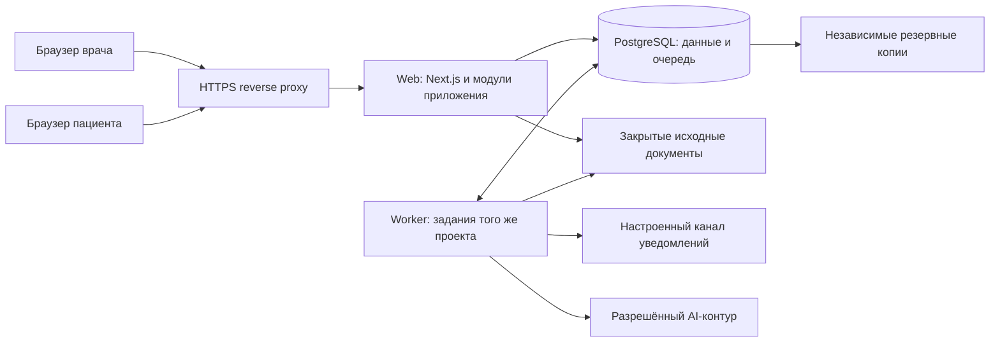

# Архитектура первой версии

Исходный статус на 17 октября 2026 (расширения 18 октября описаны в конце): архитектура частично реализована. Работают web + PostgreSQL + worker, авторизация, доступ, подключение, самоотчёты, коммуникация и техническая вертикаль «назначение анкеты → ответы → учебное событие → результат врача». Проверенные клинические определения, терапия, внешняя доставка и полный эксплуатационный контур ниже — целевое состояние. Подтверждён приоритет полезных алертов с каталогом действий и готовой LLM для текста; собственное обучение отложено. Фактический запуск и границы текущей версии описаны в README.md; сверка новых материалов — CASE_ALIGNMENT.md.

## Реализованные границы первой вертикали

- `modules/clinical`: чистая проверка определения / ответов и расчёт. Не обращается к базе, сети или LLM. Сейчас поддерживает сумму объявленных обязательных вопросов и условия по выбранному варианту ответа. Пороговые клинические правила, временная динамика и маршрутизация ещё не поддерживаются; добавлять только после проверки протокола, отдельными типизированными стратегиями, без исполняемого кода из JSON.
- `modules/assessments`: назначение, доступ, черновик, отмена и атомарная отправка. Публичный интерфейс — операции модуля; `definitions` — выделенный интерфейс чтения / проверки источника для monitoring и доверенного seed. HTTP-обработчики проверяют контракт и вызывают модуль, не рассчитывают баллы.
- `modules/monitoring/review-events`: список кратких событий, загрузка основания, принятие в работу, завершение. Предложение не выполняет медицинское действие; врач указывает фактический результат или мотивированное отклонение.
- Клиентские DTO находятся в `lib/assessments`; они не импортируют Prisma во фронтенд. Формы и workflow не зависят от конкретных двух учебных вопросов. Общие кнопки, панели, цвета и размеры целей наследуют существующую систему.

Данные: `AssessmentDefinition` (code / version / checksum / источник) → `AssessmentAssignment` (назначение и черновик) → `AssessmentSubmission` (отправленные ответы и результат) → `ReviewEvent` (основание и предложения, владелец, решение). Термины зафиксированы в CONTEXT.md. Новая публикация не меняет исторические ответы; контрольная сумма проверяется при чтении основания. Запрет изменения опубликованных определений, отправленных ответов и завершённых решений действует в прикладном интерфейсе; отдельная защита от привилегированной правки самой БД не заявляется.

Конкуренция: создание назначения блокирует только строку соответствующего пациента; черновик, отправка и разбор используют revision и условный UPDATE. Повтор отправки проверяет уникальный requestKey, автора и хеш полезной нагрузки, поэтому изменённое содержимое не считается успешным повтором. В одной транзакции записываются ответ, результат, события, аудит, история и техническое задание Graphile Worker. Это задание ещё не является внешним уведомлением.

Приватность: до отправки врач получает статус черновика, но не ответы и комментарий. Список событий содержит краткие сведения; полное основание запрашивается отдельно с повторной проверкой роли и ведущего врача. Учебные определения доступны только при DEMO_MODE=true, клинические — со статусом APPROVED; это технический барьер, а не замена экспертизе содержания.

Производительность: новые списки ограничены 20 записями и курсором, определения в ответе дедуплицируются, истории не копируются в каждое краткое событие. Запросы невидимой вкладки приостанавливаются; предыдущий запрос отменяется при смене пациента. Приватные ETag сокращают повторную передачу неизменившихся данных. Замена polling на push оправдана замерами, а не обязательна для первого монолита. Разделение врачебного списка и карточки реализовано следующим пакетом ниже.

## Реализовано: серверный каталог и отдельная карточка

- `GET /api/patients`: только врач и только его пациенты; поиск имени / номера карты, фильтр, 20 кратких строк, курсоры соседних страниц и номер страницы, глобальные счётчики, четыре ближайших контакта и первые 20 запросов подключения. Тексты сообщений, наблюдений и заметок не загружаются в список. Счётчики используют всю историю, включая просьбу вне последних 30 отметок и непрочитанное сообщение вне последних 50.
- Сначала идут пациенты с открытой просьбой или событием по анкете, затем остальные; внутри групп — updatedAt / id. Не более двух ограниченных выборок сохраняют порядок без загрузки всех карточек. Курсор содержит позицию, направление before / after, номер и область поиска / фильтра / врача / режима; смена области отклоняется. Выборка назад идёт в обратном порядке и разворачивает только полученную страницу. Поэтому reload глубокой страницы не требует локальной истории курсоров. Это не снимок базы между HTTP-запросами: новые события могут изменить порядок, поэтому актуальный набор начинается с первой страницы.
- `GET /api/patients/:id`: повторная проверка доступа; лёгкая версия проверяется до чтения тела карточки. Начальное окно — 30 наблюдений, 50 сообщений, 20 событий; дополнительно до 20 самых ранних открытых просьб и полный их счётчик. Просмотр просьбы сдвигает это окно после обновления. Доступ к карточке не зависит от её присутствия на текущей странице каталога.
- `GET /api/patients/:id/messages?before=…`: история по 50 сообщений, доступная обоим участникам; курсор проверяется в той же карточке. Отметка прочтения принимает не более 50 конкретных ID и ограничивается своим пациентом / входящими сообщениями. Открытие последних 50 больше не помечает прочитанной невидимую историю.
- `/api/workspace` GET остался пациенту для одной собственной карточки; врачу возвращает 410. POST-команды сохранены. Врачебная SSR-страница и браузер используют новый каталог / карточку, скрытый путь загрузки первых 100 карточек удалён.
- `lib/patients` задаёт DTO и параметры списка; `modules/patients/directory` скрывает запросы, подсчёт и курсор. UI не вычисляет фильтр по загруженной странице. При поиске запрос задерживается на 250 мс; отменённый / поздний ответ не подменяет выбранного пациента. Сеть может оставить показанные данные на экране, 403 / 404 очищают соответствующий ресурс. Фоновое обновление не блокирует переход к следующей странице.
- Индексы: doctorId / updatedAt / id, doctorId / nextVisit / id, состояния просьб и сообщений, GIN pg_trgm для имени / номера. Миграция явно задаёт ICU-сопоставление `kontur_search` (`und`, deterministic) для обоих поисковых столбцов: ILIKE в локали C не сворачивает регистр кириллицы. Значения сохраняются; сопоставление закреплено SQL-миграцией, Prisma не описывает его в модели. Среда должна поддерживать ICU и pg_trgm. Проверка migrate diff после применения не обнаружила расхождений схемы.

На синтетической фикстуре 120 пациентов каталог вернул все шесть страниц без дублей и корректно прошёл пять обратных переходов; максимальное JSON-тело страницы — 8226 байт, без текстов историй. Это контроль объёма ответа, не доказательство пропускной способности. Число агрегирующих запросов не растёт с числом строк страницы, но подсчёт и поиск ещё нужно измерить на больших наборах / нескольких одновременных врачах. История наблюдений / событий карточки пока ограничена начальным окном; догрузка реализована для сообщений. Запросы подключения показываются партиями по 20; после обработки первой партии появляются следующие.

Следующее расширение: проверенный клинический инструмент / протокол; затем модель подтверждённого плана и пересчёт актуальности предложений; отдельные DeliveryAttempt / состояния канала и срок реакции; AI-извлечение через фоновый адаптер с источниками и подтверждением. Эти функции добавляются за названными границами, без переноса расчёта на клиент или зависимости отправки анкеты от LLM.

Основание: повторный формальный кейс и презентация организаторов от 15 октября (пути и статус источников в CASE_ALIGNMENT.md), PRODUCT.md, UX_SCENARIOS.md и PRODUCT_PRIORITIES.md. Презентация дополняет стратегию; её трактовки ЭМК и регуляторного пути не заменяют формальное требование или заключение о нашем продукте.

## 1. Решение

Модульный монолит: один репозиторий и единая модель данных, два прикладных процесса — web и worker. Целевая клиническая логика размещается в небольшом числе модулей с компактными Interface. Вызовы между модулями выполняются внутри приложения, без сетевых запросов между ними.

Предположение: небольшая команда, первая демонстрация / пилот в одном организационном контуре. Переход к нескольким независимым медицинским организациям потребует явной модели изоляции, а не только фильтра в интерфейсе.

### Предлагаемый стек

| Задача | Выбор | Причина |
|---|---|---|
| Язык | TypeScript | Общие типы для интерфейса, модулей и фоновых задач |
| Web | Next.js + React, Node.js runtime | Интерфейс и серверные обработчики в одном проекте |
| Интерфейс | CSS-переменные и общие React-компоненты; Tailwind подключён | Реализованные формы, панели и вкладки; диалоги на нативном dialog |
| Валидация | Zod | Проверка внешних данных, конфигураций и результатов AI во время выполнения |
| Данные | PostgreSQL + Prisma | Связи, ограничения, транзакции, миграции и запросы |
| Аутентификация | Better Auth, серверные сессии | Использовать готовую реализацию входа и сессий |
| Фоновые задания | Graphile Worker, та же PostgreSQL | Надёжная очередь без отдельной базы очередей |
| Документы | Закрытый файловый том на первом узле | Простой старт; выдача только через авторизованный обработчик |
| Деплой | Docker Compose, reverse proxy с HTTPS | Один воспроизводимый комплект web, worker, PostgreSQL и proxy |
| Проверка | Vitest, интеграционные проверки с PostgreSQL, Playwright | Клинические правила, транзакции, доступ и реальные пользовательские пути |

Версии реализованного каркаса закреплены в package-lock.json; проверенный текущий запуск описан в README.md. Образы полного развёртывания ещё предстоит закрепить и испытать. Next.js применяется как постоянно работающий Node.js-процесс; работа worker не зависит от длительности HTTP-запроса или вкладки браузера.

### Схема



База данных и файлы не доступны непосредственно из браузера. В очередь передаются идентификаторы и минимальные параметры; исходные истории болезни не копируются в payload каждого задания.

## 2. Границы модулей

Принцип codebase-design: Module скрывает связанную Implementation за небольшим Interface. Не создавать отдельный модуль на каждую таблицу и цепочки pass-through-обёрток. Таблицы и ORM не являются публичным Interface прикладных модулей.

| Module | Ответственность | Примеры операций Interface |
|---|---|---|
| access | Сессии, роли, профиль врача, приглашения, подтверждение связи, серверный контроль доступа | createInvitation, requestLink, approveLink, requirePatientAccess |
| patients | Карточка, факты, документы, происхождение сведений, сводка изменений | updateClinicalFacts, getPatientOverview |
| assessments | Назначение опросов, ответы, проверка полноты, воспроизводимый расчёт шкал | assignAssessment, saveAnswers, completeAssessment |
| clinical | Версии знаний, зарегистрированные варианты терапии, ограничения, каталог действий, предложения и маршрутизация | evaluateCase, getActionProposals, explainFinding |
| care | Черновики и версии плана, подтверждение врача, задачи наблюдения, представления записи и памятки | preparePlan, confirmPlan, recordIntakeReport |
| monitoring | Проверки поступающих событий, полезные алерты, ответственность, доставка, эскалация и завершение с результатом | ingestObservation, claimAlert, resolveAlert |
| communication | Сообщения ведущему врачу, состояния передачи, связь с обращениями | sendMessage, listConversation |
| imports | Извлечение из поддерживаемых документов, структурированный AI-результат, проверка врачом | startImport, reviewExtractedFacts |

Журнал аудита и соединение с базой — общие внутренние средства. SQL и Prisma остаются в серверном коде. Простые чтения используют целевые запросы; не требуется универсальный Repository на каждую сущность или собственный DI-фреймворк.

Внешние Adapter оправданы в местах реальной изменчивости: разрешённая модель / тестовая модель, реальная отправка уведомления / тестовый отправитель. Не строить несколько гипотетических хранилищ и сложную plugin-платформу заранее.

### Связь с интерфейсом

- src/app отвечает за маршруты, отображение и тонкие серверные обработчики.
- Основные изменения проходят через команды модулей; обработчик получает проверенного actor из серверной сессии.
- Actor, роль и доступ к patientId никогда не принимаются на доверии из тела запроса.
- Route Handlers — единый внешний путь команд и клиентских запросов. Серверный рендер может читать через те же разрешённые модули напрямую, не вызывая собственный HTTP.
- Успешный ответ на изменение означает успешный commit. Долгая задача возвращает сохранённый jobId / importId и статус ожидания, а не выдуманный готовый результат.
- Медицинские ответы не помещаются в общий публичный кэш. Политики кэширования приватных страниц и запросов задаются явно.

## 3. Что выполняется синхронно и в фоне

### В HTTP-запросе

Проверка сессии и прав, валидация данных, сохранение фактов / ответов, расчёт доступных структурированных шкал, быстрые детерминированные проверки безопасности, фиксация предупреждений, запись аудита и постановка требуемых заданий в транзакции.

### В worker

Доставка и повтор уведомлений, контроль неподтверждённых критических событий, извлечение из документов, обращение к разрешённой модели, подготовка тяжёлых представлений и плановые задания.

Импорт и AI имеют отдельный ограниченный пул исполнения относительно доставки критических уведомлений. Одна большая история болезни не должна занять все доступные слоты уведомлений. Эти пулы могут запускаться в одном worker-процессе; при росте они разделяются отдельными командами из того же образа. CPU-нагрузка ограничивается размером документов, таймаутами и при необходимости изоляцией парсера.

Для первой версии открытый кабинет получает обновления коротким периодическим запросом, например раз в 5 секунд на активном экране. Скрытая вкладка снижает частоту. Частота — настройка, её влияние измеряется нагрузочным тестом. Это обновление интерфейса, не замена внешней доставке алерта. SSE можно добавить после подтверждённой необходимости; отдельный WebSocket-сервер на старте не требуется.

## 4. Критический путь: ответ пациента и алерт

Операция monitoring.ingestObservation получает доверенного actor, данные и ключ идемпотентности.

1. Проверяет доступ пациента к своей записи, схему, время и допустимость события.
2. Готовит расчёты применимых быстрых правил на согласованной версии данных и правил. Не ждёт LLM или внешнюю сеть.
3. В одной транзакции PostgreSQL сохраняет исходное событие / ответы, результат оценки с версиями, новый алерт при наличии основания, аудит и задание уведомления через graphile_worker.add_job.
4. При конфликте актуальности данных / плана пересчитывает либо возвращает контролируемый конфликт. Ни один расчёт не публикуется как актуальный без фиксации исходной версии.
5. После commit возвращает подтверждение сохранения. Worker видит задание после commit и отправляет уведомление.
6. Попытки и фактические статусы записываются отдельно; ошибки приводят к ограниченным повторам и предусмотренной организационной эскалации.

Graphile Worker документирует добавление задач SQL-функцией. Её вызов через параметризованный запрос Prisma должен использовать то же транзакционное соединение, что и запись события. Отдельный вызов addJob на другом соединении после commit не обеспечивает требуемую атомарность. Интеграционный тест с rollback обязателен.

### Повторы и сбои

- Уникальный ключ отправки исключает повторную запись одного самоотчёта при сетевом retry.
- Worker обеспечивает выполнение at least once. Обработчики рассчитаны на повтор; очередь не обещает exactly once для внешнего SMS / email.
- У каждой доставки есть устойчивый deliveryId, ограничение уникальности и provider idempotency key, если канал его поддерживает.
- При сбое между внешней отправкой и записью результата возможен повтор уведомления. Это фиксируется как ограничение; потерю критического события нельзя маскировать попыткой обеспечить абсолютное отсутствие дублей.
- Принятие провайдером, подтверждённая доставка, прочтение и взятие в работу — разные состояния.
- После перезапуска worker продолжает сохранённые задания. Параметры возврата зависших заданий и предельного числа попыток настраиваются и проверяются испытанием.
- Новое ухудшение не закрывается и не подавляется из-за ранее обработанного события.
- При недоступности базы браузер не получает «успешно отправлено». Показывает отсутствие подтверждения и применимые статические инструкции; система не утверждает, что врач уведомлён.

Сообщения в свободном тексте также проходят предусмотренную проверку признаков и при необходимости дополнительную асинхронную обработку. Нельзя утверждать полноту выявления всех критических состояний по произвольному тексту. Поддерживаемые признаки, задержки, ложные срабатывания и пропуски проверяются отдельно; структурированный канал сообщения о проблеме остаётся доступен.

### Канал вне браузера

Нужен реальный настроенный канал, например проверенный email / SMS / web push, выбранный по организационным требованиям. Для демонстрации допустим один реальный канал с минимальным содержимым и ссылкой на авторизованную карточку. Подменённый отправитель маркируется тестовым и не выдаётся за фактическую доставку. Медицинские подробности не включаются в публичное push-уведомление или тему письма.

Пригодность канала для клинического сопровождения, расписание врача, порядок замещения и сроки реакции утверждаются отдельно. Уведомление само по себе не является системой круглосуточной помощи.

### Полезное событие и предложения действий

Алерт опирается на устойчиво сохранённые факты и DecisionEvaluation. Он содержит patientId, исходные eventId, время события и получения, тип события, основание внимания, срочность по проверенному правилу, версии данных / оценки / плана / правила / источника, недостающие сведения, предложения из каталога и ответственного со сроком по протоколу. Критичность не выводится из самого слова «обязательно» в маршрутизации.

Обычное обновление не обязательно становится внешним уведомлением: учитываются тип, новизна и возможность полезной реакции. Группировка не задерживает новый критический сигнал и не переносит на него завершение прошлого события. Факт нового симптома хранится отдельно от гипотезы о его связи с препаратом.

Раздельные состояния:

- Событие: открыто / взято в работу / завершено с результатом; ложное срабатывание требует объяснения и сохраняется в истории.
- Ответственность: ведущий врач / уполномоченный замещающий / нет доступного ответственного. Замещение требует явного разрешения доступа, не автоматической выдачи чужой карточки.
- Доставка: запланирована / отправляется / принята провайдером / подтверждена / ошибка; просмотр фиксируется отдельно при наличии подтверждения.
- Клиническое действие: предложено / подтверждено врачом / выполняется / выполнено либо мотивированно отклонено. Это не тот же статус, что «алерт просмотрен».

До выполнения клинического действия проверяются роль, доступ, актуальность исходных данных и плана. При изменении оснований предложение пересчитывается и требует повторной проверки врача. Нажатие «Взять в работу» не подтверждает план и не доказывает контакт с пациентом. Завершение содержит результат, ссылку на действие / новую версию плана и следующий контроль, когда он нужен.

## 5. Врачебное подтверждение и версии

Сущность PlanVersion содержит patientId, статус, номер версии, исходную clinicalDataVersion, версию знаний, автора проекта, подтвердившего врача и время подтверждения.

Состояния: draft → confirmed; отменённый черновик сохраняет свой статус. Историческая подтверждённая версия не редактируется. Текущее состояние определяется ссылкой на актуальную версию, а не перезаписью прежних назначений.

care.confirmPlan выполняет в одной транзакции:

1. Проверку активной связи врача и пациента и применимых полномочий.
2. Проверку ожидаемой версии плана и исходных клинических данных.
3. Повторную проверку актуальных ограничений / существенных предупреждений.
4. Фиксацию утверждённой версии лекарственных и иных рекомендаций, задач наблюдения и решений маршрутизации.
5. Обновление ссылки на действующую версию, аудит и задание уведомления пациента.

Устаревший проект нельзя подтвердить поверх изменившихся сведений молча. Возвращается конфликт с предложением повторной проверки. Повтор одного запроса не создаёт вторую подтверждённую версию.

Система отдельно хранит предложение маршрутизации, решение врача и фактический результат организации направления. Статус «обязательно» не означает, что направление уже совершено; обязательность и срочность — разные поля.

Проекты записи для врача и памятки пациенту используют одни структурированные назначения. Текст проверяется врачом; AI не может незаметно изменить режим между двумя представлениями. Врачебное подтверждение в интерфейсе не объявляется автоматически юридически значимой электронной подписью.

## 6. Клиническая логика и обновление знаний

### Детерминированная часть

Расчёт инструментов, проверки зарегистрированных показаний и ограничений, категории маршрутизации и поддерживаемые признаки алерта реализуются воспроизводимо. Словесное объяснение ссылается на реально сработавшие правила, а не на сгенерированное обоснование задним числом.

### Каталог действий

ActionDefinitionVersion задаёт id / версию, подпись, условия применимости, обязательные данные, ограничения, допустимую роль, параметры, источник / раздел, требование врачебного подтверждения и ожидаемый результат завершения. RuleSet выбирает допустимые действия; ActionProposal связывает их с конкретной версией фактов и оценки. Решение врача и причина отклонения фиксируются отдельно.

Первая реализация — проверенные определения и шаблоны в данных / TypeScript, без визуального конструктора и универсального движка. Для неподдерживаемой ситуации выводится граница покрытия и необходимость уточнения. Неизвестность, неполная анкета и конфликт источников не получают автоматически статус «рисков нет».

Категория внимания, срочность реакции, обязательность маршрутизации и предупреждение о терапии — разные признаки. Каталог не содержит свободно сгенерированных LLM назначений. Изменение терапии и направление выполняются только через разрешённую команду с явным решением врача.

### Версионируемые определения

- ScaleDefinition: идентификатор, версия, язык, полный текст, порядок вопросов, ответы, период оценки, алгоритм расчёта, обработка пропусков, валидация и лицензия.
- RuleSet: поддерживаемые условия и операторы, приоритет, ограничения применимости, категория результата, sourceId / раздел, версия и статус.
- DrugDefinition: регистрационная запись, показания, противопоказания, проверяемые взаимодействия и режимы, ссылки на действующую инструкцию, дата проверки актуальности.
- SourceVersion: вид документа, издатель, версия / дата, точная ссылка / раздел, статус проверки и контрольная сумма сохранённого материала при наличии законного основания хранения.

Черновик знаний проходит проверку схемы, клиническую проверку и набор эталонных случаев до публикации. Предыдущая версия сохраняется, опубликованная версия неизменяема. В первой версии публикация может быть проверяемой командой / миграцией, без редактора медицинских правил в интерфейсе.

Обычная новая суммируемая шкала или правило из поддерживаемых операторов добавляется данными, без изменения ядра. Новый нестандартный алгоритм может потребовать отдельной стратегии в модуле assessments; это честная граница расширяемости. Произвольный JavaScript / eval в данных не выполняется.

Каждый результат содержит идентификаторы версий правил и фактов. Изменение источника не переписывает историю; при необходимости создаётся отдельная задача переоценки текущих случаев и уведомление об изменившемся основании. Неподдерживаемый случай получает явное ограничение, а не импровизированную рекомендацию.

Клинические рекомендации и действующая инструкция ГРЛС — разные основания. Международный источник помечается дополнением. «Авиандр» рассматривается в клинически проверенных синтетических сценариях с профилем, вариантами лечения и маршрутом; наличие препарата в кейсе не создаёт показаний автоматически.

## 7. AI и импорт

AI помогает извлекать сведения и составлять проверяемые проекты резюме. У него нет Interface подтверждения плана, изменения ведущего врача или отправки клинического назначения.

Решение первой версии: готовая LLM через один заменяемый Adapter, без обучения собственной модели и без fine-tuning. Выбор провайдера / модели определяется разрешённым контуром и результатами проверки на нашем наборе. Расчёт анкет, правила внимания, каталог действий и критическая доставка не зависят от вызова модели.

Первое применение — извлечение из разнородного медицинского текста. Структурированные анкеты не отправляются модели ради расчёта баллов. Вторичные текстовые сводки могут объяснять только переданные проверенные факты, правила и источники; они не меняют срочность, состав допустимых действий или план. Первая запись врача и памятка формируются шаблонами из одной подтверждённой структуры.

Путь импорта:

1. Авторизованная загрузка с ограничением типа, размера и расширенного содержимого архивных форматов; файл сохраняется вне public.
2. Поддерживаемый парсер извлекает текст. Для первой версии: вставленный текст, PDF с текстовым слоем и DOCX. Скан без OCR получает понятное сообщение о неподдерживаемом формате.
3. Worker передаёт допустимые данные разрешённому обработчику, получает структурированный результат и проверяет Zod-схемой.
4. Для фактов сохраняются документ, фрагмент, позиция, дата / отрицание / неопределённость и статус проверки. Нельзя считать отсутствие упоминания отрицательным результатом.
5. Врач видит конфликтующие и значимые непроверенные сведения, исправляет их и подтверждает. Исходный документ не исполняет инструкции и не может вызвать инструменты.

ExtractionRun хранит версию модели, инструкции, схемы и исходного документа. Проверяются существование цитаты в исходном тексте, отрицания, время, статус назначения и неизвестность. Корректная JSON-схема не доказывает истинность извлечённого факта; self-reported confidence модели не заменяет разметку и проверку врача. Новое дообучение рассматривается только после измеренных ошибок готовой модели и появления достаточных разрешённых размеченных данных — как отдельное решение.

При таймауте AI сохраняется понятный статус ошибки и доступен ручной ввод. Повторы ограничены, размеры и сроки задач контролируются. Результат от старой версии документа не перезаписывает исправления врача.

Для демонстрации используются синтетические данные. Реальные медицинские сведения не отправляются произвольному внешнему AI-провайдеру по умолчанию. Для внедрения выбирается разрешённый контур обработки, хранения и договорных условий. Замена имени не объявляется гарантией обезличивания свободного текста.

## 8. Модель данных

Отношения и права — в обычных таблицах; гибкие ответы и снимки определений могут использовать JSONB. Не хранить всю карточку одним изменяемым JSON.

| Группа | Основные сущности |
|---|---|
| Доступ | User, Session, PractitionerProfile, PatientProfile, CareRelationship, Invitation, LinkRequest |
| Факты и документы | ClinicalFact, ClinicalDataRevision, SourceDocument, ExtractionRun, FactProvenance |
| Инструменты | ScaleDefinitionVersion, AssessmentAssignment, AssessmentResponse, AssessmentResult |
| Знания | SourceVersion, RuleSetVersion, DrugDefinitionVersion, ActionDefinitionVersion, KnowledgeRelease |
| Решения | DecisionEvaluation, Finding, ActionProposal, ActionDecision, ReferralProposal, ReferralDecision |
| План | CarePlan, PlanVersion, PlanItem, FollowUpTask |
| Самоотчёты | IntakeReport, SymptomReport, AdverseEventReport |
| Общение | Conversation, Message, MessageReceipt |
| Алерты | Alert, AlertEvent, AlertAssignment, AlertResolution, NotificationDelivery, DeliveryAttempt, AlertAcknowledgement |
| Надёжность | AuditEvent, IdempotencyRecord; технические таблицы очереди Graphile |

### Основные ограничения

- У пациента одна активная связь с ведущим врачом; уникальный частичный индекс / соответствующее транзакционное ограничение предотвращает гонку при назначении.
- Запрос связи не предоставляет доступа. Старую связь нельзя незаметно заменить новым QR.
- Приглашение одноразовое, с ограниченным сроком, хешированным секретом и лимитом попыток короткого кода. Погашение и создание связи атомарны.
- Актуальная версия плана одна; прошлые версии неизменяемы.
- Уникальные ключи исключают дубли самоотчётов, подтверждений и логических доставок.
- Время сохраняется в UTC; отображение учитывает часовой пояс. Время события и поступления различаются.
- Самоотчёт о приёме отличается от неизвестности и отсутствия отчёта.
- Исходные данные, их происхождение и результат обработки связаны явными идентификаторами.

Нужны индексы по doctorId / active relationship, patientId + occurredAt, активным алертам + приоритету, получателю / статусу доставки и назначенным задачам + сроку. Списки пагинируются; запросы «Обзора» выбирают нужные поля, не всю историю и все вложения.

## 9. Доступ, сессии и конфиденциальность

- Better Auth отвечает за вход и серверную сессию; авторизация конкретного пациента остаётся обязанностью модулей приложения.
- Пациент может зарегистрироваться только как пациент. Профиль врача активируется доверенным процессом; пользователь не назначает себе роль или специальность из формы.
- Врач работает только с разрешёнными пациентами. Специальность не даёт общего доступа ко всем карточкам.
- Для реального применения нужны проверка статуса врача и идентификация пациента. Конкретный способ повторного входа и восстановления выбирается отдельно; подтверждение email / телефона не приравнивается автоматически к проверке личности.
- Сессии передаются защищёнными cookie с HttpOnly / Secure и подходящей SameSite-политикой. Запросы изменения защищаются от CSRF; режим доверенных origins настраивается.
- Браузер не получает секреты модели, БД или канала отправки. Медицинские сведения не помещаются в URL, общий кэш, аналитические события или localStorage по умолчанию.
- Логи содержат технические идентификаторы и минимальные сведения об ошибках. Аудит доступа и решений отделён от обычных логов; доступ к нему ограничен.
- Закрытые файлы выдаются через авторизацию, с безопасными именами и подходящими заголовками; worker и web имеют только необходимые права.
- Черновики сохраняются на сервере с контролем доступа. При потере сети интерфейс честно показывает отсутствие сохранения; постоянный офлайн-кэш медицинских сведений не включается автоматически.
- Миграционный доступ и runtime-доступ к PostgreSQL разделяются; БД и её технические порты не публикуются в интернет.

Архитектура поддерживает выполнение требований РФ, но название библиотеки, HTTPS или размещение сервера сами по себе не доказывают правовое соответствие. Перед реальными данными определяются размещение, правовые основания, согласия, сроки хранения / удаления, организационные меры и применимые требования к программному продукту.

## 10. Развёртывание, восстановление и рост

### Первая установка

Один Linux-узел, Docker Compose:

- proxy — HTTPS и маршрутизация;
- web — приложение;
- worker — задания из того же релиза;
- postgres — постоянный том;
- отдельный закрытый том документов.

Это простой старт с единой точкой отказа хоста. Перезапуск процесса и полная потеря узла — разные сценарии. Том не является резервной копией.

### Резервирование

Для демонстрации и начальной разработки — регулярный логический backup и проверка восстановления с честно указанной возможной потерей после последней копии. Такая схема не обещает сохранность всех критических данных при потере узла.

Для пилота с требованиями к малой потере данных — физические базовые копии PostgreSQL и непрерывное архивирование WAL в независимое хранилище, резервирование закрытых файлов и проверка согласованного восстановления. Использовать готовый механизм / инструмент; pg_dump сам по себе не даёт PITR. Доступ и ключи к копиям хранятся отдельно от публичного приложения.

Исходные файлы после завершения загрузки сохраняются под неизменяемым идентификатором / хешем, затем на готовый файл фиксируется ссылка в БД. Неудачная транзакция может оставить закрытый сиротский файл для последующей уборки, но не должна создавать ссылку на ещё не записанный документ. Файловый архив сохраняет объекты на весь допустимый горизонт восстановления БД; наличие объектов проверяется при восстановлении. Удаление и сроки хранения согласуются с принятой политикой данных.

RPO (возможная потеря данных) и RTO (время восстановления) согласуются и измеряются испытанием. До измерения не объявлять значения достигнутыми. Даже PITR с асинхронным архивированием не означает нулевую потерю при любой катастрофе; для строгого RPO=0 нужен более сложный режим синхронного резервирования.

После восстановления проверяются версии плана, сохранённые критические события, очередь, идемпотентность и возобновление доставок. Внешняя доставка во время аварии может потребовать сверки с провайдером.

### Рост по измеренной необходимости

1. Настроить запросы, индексы, пагинацию и лимиты пулов подключений.
2. Добавить worker-процессы по типам задач; контролировать нагрузку на ту же БД.
3. При росте перенести PostgreSQL на выделенный / управляемый контур и документы в закрытое объектное хранилище.
4. Добавить экземпляры web; обеспечить общие сессии, приватную политику данных и корректное согласование необходимых кэшей.
5. Выделять самостоятельный backend или отдельный модуль в сетевой процесс только при конкретной причине: нагрузка, отдельная команда, требования изоляции.

Redis, Kafka, Kubernetes, Elasticsearch и векторная БД не являются обязательными для описанных сценариев. Решение о добавлении основывается на измерениях, а не на полноте списка технологий.

## 11. Наблюдаемость и проверки

### Что измерять

- Задержку интерфейса и серверных операций по p50 / p95, ошибки и число успешных сценариев.
- Время от приёма критических данных до создания алерта, начала отправки, подтверждённого статуса канала и принятия врачом в работу — отдельно.
- Возраст старейшего критического задания, число попыток, зависших и окончательно неуспешных доставок.
- Точность и полноту извлечения по полям на размеченных историях разных шаблонов; отрицания, пропуски и конфликты — отдельными группами.
- Время и число действий пользователя, возвраты и обращения за помощью.
- Поведение при заданном количестве одновременных сессий, объёме данных и сценарии нагрузки.
- Фактические RPO / RTO и восстановление критических событий.

Worker публикует heartbeat и состояния пулов; web — readiness с проверкой необходимых зависимостей. О сбое доставки и остановке worker нужен технический канал, не зависящий только от очереди, которая могла сломаться. На старте достаточно проверок и структурированных логов; отдельная большая платформа мониторинга не обязательна.

### Обязательные проверки по риску

1. Чужой patientId закрыт и для чтения, и для изменения; worker также проверяет применимость адресата на момент отправки.
2. Пациент не может подтвердить план или активировать себе роль врача.
3. Два одновременных погашения приглашения не создают две связи.
4. Устаревшая версия плана / фактов не подтверждается без пересмотра.
5. Эталонные случаи для расчёта шкал, ограничений, маршрутов и алертов; источники и версии воспроизводимы.
6. Rollback не оставляет ни события, ни задания; commit оставляет оба.
7. Перезапуск worker после commit продолжает уведомление; повтор не создаёт второе клиническое действие.
8. Сбой провайдера сохраняет событие, повторяет попытки и отображает достоверный статус.
9. Отказ AI сохраняет доступность ручного сценария и независимых проверок.
10. Сквозной путь: QR → самоотчёт → карточка своего врача → подтверждённый план → отображение у пациента.
11. Восстановление из копии возвращает карточку, версии, исходные документы и критические задания в согласованном состоянии.

Проверки выполняются при реализации. В текущем документе описан план, а не результаты тестирования.

## 12. Соответствие кейсу

| Требование | Архитектурное решение | Доказательство при реализации |
|---|---|---|
| Две роли, связь с ведущим врачом | access, CareRelationship, атомарное подключение | Проверки разрешённого и запрещённого доступа |
| Стандартизированная оценка | assessments, версионированные определения и расчёты | Эталонные ответы, полнота, валидация и лицензии |
| Варианты терапии и риски | clinical, факты и проверенные версии источников | Объяснимое finding и проверка ограничений |
| Только врач подтверждает действия | care, версии и защищённая команда confirmPlan | Попытка пациента отклонена; draft не виден как назначение |
| Динамика и самоотчёты | События, AssessmentResult, IntakeReport, SymptomReport | Повторный приём и собственная динамика пациента |
| Коммуникация и приверженность | communication, самоотчёты с неопределённостью | Переписка, статусы, пропуски и отсутствие данных различаются |
| Маршрутизация | ReferralProposal / Decision, обязательность и срочность | Система предлагает, врач подтверждает, событие отслеживается |
| Алертинг | monitoring + транзакционная очередь + worker + реальный канал | Commit, сбой, повтор, доставка и реакция |
| Сценарии с «Авиандром» | Версионированные знания и синтетические случаи | Профиль, предложения по терапии, маршрут и источники |
| Источники и ограничения РФ | KnowledgeRelease, DrugDefinitionVersion, SourceVersion | Сверка с действующими КР и ГРЛС; проверенное покрытие |
| Скорость и устойчивость | Синхронные быстрые проверки, фоновые задачи, индексы | Замеры HTTP, алерта, нагрузки и ошибок |
| Разные истории болезни | imports, происхождение фактов и проверка врачом | Размеченный набор разных шаблонов |
| Кроссплатформенность | Адаптивный web, серверные данные | Проверка браузеров и размеров экрана |
| Рост и гибкость | Модули, конфигурации знаний, масштабируемый worker | Новая поддерживаемая шкала / правило и повторные тесты |
| Полнота и гибкость данных | Связанные таблицы + ограниченный JSONB + миграции | Запросы по кейсам и расширение модели |
| Восстановление и защита | Транзакции, аудит, закрытое хранилище, backup / WAL | Испытание восстановления и доступа; отдельная правовая проверка |

## 13. Структура репозитория

```text
src/
  app/
    doctor/
    patient/
    api/
  components/
    ui/
    patient-overview/
    assessment-form/
    plan-review/
  modules/
    access/
    patients/
    assessments/
    clinical/
    care/
    monitoring/
    communication/
    imports/
  server/
    db.ts
    auth.ts
    audit.ts
    configuration.ts
  worker/
    index.ts
    tasks/
  knowledge/
    schemas/
    fixtures/
prisma/
  schema.prisma
  migrations/
tests/
  integration/
  e2e/
  clinical-fixtures/
infra/
  compose.yaml
  backup/
```

Это схема будущего проекта. У каждого модуля небольшой публичный index.ts с Interface; лишние внутренние слои добавляются только по конкретной потребности. Worker импортирует разрешённые Interface тех же модулей, а не копирует клинические правила.

## 14. Порядок реализации

1. Каркас, база, вход, доверенные тестовые аккаунты, закрытый доступ и миграции.
2. Приглашение, запрос и подтверждение связи; два связанных браузера.
3. Один проверенный инструмент оценки, самоотчёт, клинические факты и динамика.
4. Правила по эталонным случаям, источники, проект плана и подтверждение врачом.
5. Полезный алерт с каталогом действий, основанием и ответственным; транзакционная постановка задания, реальный канал, повторы, принятие в работу и зафиксированный результат.
6. Переписка и самоотчёты о приёме / переносимости с проверкой событий.
7. Импорт, сводка изменений, запись для врача и памятка из одного плана.
8. Полные синтетические сценарии терапевта и психиатра, нагрузка, отказ, восстановление и пользовательская проверка.

Роли, атомарность, версии и права закладываются сразу. Тяжёлый AI-импорт подключается после работающего клинического цикла; его отказ не должен разрушать обязательный ручной путь.

Календарные ориентиры, первая вертикаль 0 → 3 → 4 и определения готовности находятся в DEVELOPMENT_PLAN.md. Матрица CASE_ALIGNMENT.md отделяет реализованный каркас от планируемого клинического покрытия; данный список не является заявлением о выполнении этапов.

## 15. Проверенные технические источники

Проверено по первичным официальным документам при подготовке архитектуры; конкретные версии и интеграции всё равно фиксируются и испытываются при реализации.

- Next.js, Self-Hosting: Node.js / Docker, reverse proxy и особенности нескольких экземпляров. https://nextjs.org/docs/app/guides/self-hosting
- Next.js, Authentication: серверная проверка авторизации и организация доступа к данным. https://nextjs.org/docs/app/guides/authentication
- Prisma, Transactions and batch queries: транзакции, идемпотентность, optimistic concurrency control. https://www.prisma.io/docs/orm/v7/prisma-client/queries/transactions
- Better Auth, Security: сессии, origins и защита запросов. https://better-auth.com/docs/reference/security
- Graphile Worker, Introduction: PostgreSQL-очередь, at least once и повторы. https://worker.graphile.org/docs
- Graphile Worker, Adding jobs through SQL: функция graphile_worker.add_job. https://worker.graphile.org/docs/sql-add-job
- PostgreSQL, Continuous Archiving and PITR: физические копии, WAL и ограничения pg_dump. https://www.postgresql.org/docs/current/continuous-archiving.html

## Подтверждаемый план наблюдения: реализованный модуль

`modules/care` владеет приватным черновиком, неизменяемыми версиями, задачами и самоотчётами. `/api/care` проверяет сессию, роль, владение карточкой, Origin, размер и схему команды. Пациент получает только подтверждённый план и опубликованную историю; рабочая заметка врача исключена из пациентских DTO.

Запись черновика использует ревизию. Подтверждение в одной транзакции блокирует строку пациента, проверяет ревизию и основание, создаёт версию / связи задач, переключает действующий план, проецирует дату контакта, пишет историю / аудит и техническое задание Graphile. UUID и хеш команды обеспечивают повтор подтверждения без дубля. Сохранение черновика не выпускает план пациенту.

Основание — хеш версии новых данных, действующего плана, владельца карточки и даты контакта. Новые самоотчёты, отправленные анкеты и отметки задач увеличивают версию данных; чтение сообщений и рабочая заметка её не меняют. При изменении основания врач должен явно подтвердить просмотр актуальных данных и сохранить черновик с новым основанием. Это проверка версии, а не автоматическое доказательство клинической полноты.

Задача неизменяема: одинаковое содержание сохраняет ID между версиями и переносит самоотчёт; изменение содержания создаёт новый ID. Самоотчёты добавляются ревизиями. История версии показывает последнюю отметку по задаче из этой или более ранней версии, без будущих отметок следующего плана. Это историческое состояние версии, а не точный срез на момент её подтверждения. Вопрос по задаче атомарно создаёт обычное сообщение с контекстом и попадает в существующую очередь непрочитанных. Статус анкеты определяется фактической отправкой, ручная отметка DONE не разрешена.

Чтение ограничено: до 8 задач, по одному последнему самоотчёту на задачу, 20 версий на страницу, 20 свежих активных анкет плюс до 16 связанных назначений. Длинная история загружается отдельно. Блокировки действуют внутри одной карточки, без глобальной очереди. После появления плана дату контакта меняют только через его новую подтверждённую версию.

Текущий план описывает сопровождение, а не лекарственную терапию. Клинические материалы, предложения терапии, обработка переносимости и приверженности, внешняя доставка и регуляторная оценка остаются следующими этапами. Техническое задание worker не означает отправленного внешнего уведомления.

## Клинические сведения: реализованный модуль

`modules/clinical-profile` хранит неизменяемые версии структурированных сведений. Состояния / ограничения, аллергии / реакции и препараты различают UNKNOWN, NONE с источником отрицательного ответа и KNOWN с источником каждой записи. Для препаратов отдельно хранятся сообщённые TAKING / STOPPED / UNKNOWN, режим как текст источника и известные даты. Это фиксация исходных сведений; проверка лекарственных ограничений и рекомендации пока не подключены.

POST `/api/clinical-profile` — только своему ведущему врачу, с Origin, строгой схемой, лимитом тела, ожидаемой версией и явной проверкой ввода. Транзакция блокирует одну строку пациента, проверяет повтор по UUID и хешу команды, создаёт версию, меняет указатель актуальных сведений, увеличивает clinicalDataVersion, пишет аудит и общее событие с техническим заданием. В пациентское событие не копируется содержимое сведений. Отсутствие изменений не создаёт версию. Конфликт не перезаписывает предыдущие данные.

GET текущих сведений использует частный ETag по актуальному указателю после проверки роли и владения; ответ 304 не читает полный JSON. История — по 20 метаданных версий, содержимое выбранной версии загружается отдельно. В разделе ограничение 20 записей, три раздела, каждая строка и источник имеют ограничения длины. Новые поля и алгоритмы могут требовать следующей версии схемы; текущий контракт не принимает неизвестные поля.

Подтверждение плана сохраняет идентификатор использованной версии сведений вместе с clinicalDataVersion. Изменение сведений устаревает черновик и отмечается после подтверждения плана; старый план не получает новые факты задним числом. Связь с версией хранится как неизменяемый идентификатор, разрешается только в рамках своей карточки; публичная пациентская выдача плана его не раскрывает. Чтение исходных сведений доступно только врачу с текущим правом на карточку.

Приватный ввод до сохранения хранится в памяти вкладки отдельно по пациентам. Смена статуса временно сохраняет введённые строки, позволяя вернуться; отправляется только выбранная ветка. Изменение / очистка ранее сохранённого раздела создаёт новую полную версию, прежняя доступна в истории. Автоматического слияния клинических данных из конкурирующих вкладок нет: врач сравнивает актуальную версию со своим вводом.

Описания состояний и режимов пока вводятся свободным текстом. Этот текст не используется для автоматического определения противопоказаний, взаимодействий или срочности по совпадению слов. Следующий каталог действий требует проверенных структурированных признаков / справочников и источников; одна заполненная карточка не заменяет их. Ручные источники сохраняются; источник из импорта дополнительно содержит идентификатор закрытого текста, checksum, точные границы / цитату и при наличии идентификатор результата извлечения.


## Разбор события: основание и выполненные действия

`modules/monitoring` отделяет исходное правило анкеты, версию основания и факт выполнения действия. `action-catalogue.ts` содержит версию 1 организационных возможностей: разбор ответов и контакт. Источник предложения остаётся в проверяемом определении анкеты; каталог описывает допустимые способы выполнения, без лекарственных рекомендаций или медицинской срочности. Перед разбором исходное определение повторно проверяется по checksum, предложения сверяются с детерминированным результатом исходных ответов.

При принятии в работу создаётся неизменяемая `ReviewBasisVersion`: исходные предложения, checksum определения, снимок каталога с checksum, идентификаторы версий сведений / плана, неизвестные разделы, последние самоотчёт / анкета / входящее сообщение и token контекста. Это ограниченный контекст, не полная история и не доказательство достаточности данных. Token включает clinicalDataVersion, владельца, подключённого пользователя, версии сведений / плана и последнее входящее сообщение. Новые сведения, ответы, отчёты задач или входящее сообщение требуют явной проверки и новой версии основания. Чтение и сообщение врача не устаревают основание.

Команды claim / refresh-context / send-message / resolve блокируют только строку соответствующего пациента. При отправке или завершении сервер заново проверяет token, владельца события, ожидаемую ревизию и допустимость действия. UUID и хеш смыслового содержимого позволяют повторить команду после потери ответа; повтор другого содержимого отклоняется. Сообщение, `ReviewMessageExecution`, ревизия события и аудит сохраняются одной транзакцией. Это факт сохранения в переписке, не доказательство прочтения, ответа или завершённого контакта. Сохранение сообщения не запускает внешнюю доставку. У событий анкет есть отдельный email-outbox; его принятие SMTP не подтверждает прочтение.

Итог различает NOTE, IN_APP_MESSAGE с существующим подтверждением сохранения, OTHER_CHANNEL как результат со слов врача и DECLINED. После завершения результат и использованное основание не перезаписываются новыми фактами. Старые завершённые события без основания остаются историческими; для старого незавершённого события врач может явно создать основание. Добавочная миграция `20261018020000_review_decisions` не достраивает историю задним числом.

Список событий и метаданные истории ограничены 20 записями, подтверждения сообщений — последними 10 и отдельным счётчиком. Историческая версия и подробные сведения / план загружаются отдельно с повторной проверкой доступа. Снимок хранит версии источников, а не копирует все клинические сведения в каждое событие. Доступ ко всем версиям определяется текущим владением карточкой. Сроки хранения и архивирование требуют эксплуатационной политики; сейчас история не удаляется автоматически.


## Расширения сопровождения и ограниченные чтения

Модули `follow-up`, `documents`, `notifications` остаются внутри монолита с отдельным worker. Отдельного сервиса управления анкетами / контентом нет: реальные определения и клинический каталог добавляются в существующие версионные контракты после получения материалов.

`CareDailyReport` — неизменяемая ревизия за календарный день Europe/Moscow; уникальность задача / день / ревизия, UUID и hash обеспечивают конкуренцию и сетевой повтор. Только текущий день и действующая задача доступны для новой отметки. Неизменённая ежедневная задача переносит идентичность между версиями, изменённая получает новый ID. Журнал читает до 14 дней, последнюю ревизию выбирает DISTINCT ON по индексу. Старый план ограничен датой следующей версии. `PatientConcern` фиксирует сообщение, самооценку влияния и источник плана, создаёт одну запись переписки атомарно; отметка просмотра не завершает проблему. Изменения увеличивают clinicalDataVersion и устаревают основание разбора.

`Referral` хранит явное решение врача и версии исходных данных. CAS-ревизия, свежий token и UUID защищают подтверждение / статус; `ReferralUpdate` сохраняет историю. Законченные направления не редактируются новой сменой статуса. Список текущих ограничен двумя строками на обзоре, полная история — 20 на страницу. Указанная срочность — ввод врача, не системная оценка.

`patients/history` объединяет самоотчёты, события и результаты анкет по 30 записей. Курсор привязан к владельцу через карточку, периоду, якорю времени и существующей записи; равные timestamp / ID упорядочены также по виду. Окно фиксируется до окончания догрузки. Каждая выдача заново проверяет доступ. Документы плана формируются чистыми шаблонами по точной подтверждённой версии; HTML экранируется, CSP запрещает скрипты, кэш приватных ответов отключён.

## Извлечение из закрытого текста

`ClinicalDocument` неизменяем, хранит текст / checksum и принадлежность карточке. `DocumentExtraction` сохраняет версию модели, инструкцию facts-1, схему, входной hash, попытки, состояние и проверенный результат. Вход ограничен 60000 символов; list выдаёт только метаданные по 20, текст / результат читаются отдельно после проверки роли и владения. Новое извлечение требует подтверждения внешней передачи и явной настройки; нет автоматического запасного провайдера.

OpenAI Responses API вызывается REST-адаптером со strict JSON schema, store:false, лимитами времени / ответа и без инструментов. Каждый фрагмент должен единственным образом встречаться в источнике; границы вычисляет локальный код. Извлечение не принимает решений. Отрицание ITEM не становится отрицанием SECTION, UNKNOWN не становится отсутствием. Подготовка переноса только возвращает проект; врач явно выбирает добавление / замену / сохранение раздела и отдельно сохраняет версию через существующий редактор. Сохранение проверяет checksum, владельца документа, точную цитату и при наличии READY-результат. Исходные факты не превращаются в системные диагнозы или назначения.

Worker захватывает задание через сравнение состояния / времени / попытки, повторяет только ограниченные технические сбои. Недостоверный JSON / цитата требуют нового запуска. Результат после смены владельца не публикуется. При отключённой модели ручной путь работает. Контекст HTTP-сессии загружается только при requireActor, доменные guards доступны worker без next/headers.

## Email-outbox и границы гарантий

Каждый новый ReviewEvent получает NotificationDelivery в той же транзакции; при настроенном канале Graphile job тоже записывается атомарно. NOT_CONFIGURED честно сохраняется даже без канала. Отправщик получает минимальные ID и email врача, письмо содержит защищённую ссылку без клинического текста. TLS / STARTTLS обязателен, APP_ORIGIN только корневой HTTPS. Внешние журналы / ответы провайдера не печатаются.

CAS-захват создаёт NotificationAttempt. До трёх безопасных технических попыток; неизвестный результат передачи и прерванный SENDING не повторяются автоматически. Ручной повтор проверяет текущего владельца / незавершённое событие / ревизию / UUID, для UNCERTAIN требуется признать риск дубля. ACCEPTED фиксирует только ответ SMTP. Exactly-once у внешней системы, доставка в ящик, прочтение и экстренная эскалация не гарантируются. Долгий импорт и email выполняются разными пулами concurrency 1 и 2 в одном worker; очередь остаётся PostgreSQL.

## Проверка и восстановление

Локальный backup экспортирует repeatable-read snapshot, pg_dump custom и checksum. Проверка восстановления использует только проверенное имя временной БД, сравнивает счётчики основных доменных таблиц и удаляет временную БД; это не полная побитовая проверка и не независимое хранение. Скрипт чтения измеряет ограниченную синтетическую нагрузку. GitHub Actions описан; удалённый запуск CI и публичное HTTPS-развёртывание пока не подтверждены. Локальная проверка контейнеров и TLS описана ниже. Отсутствующие клинические данные не заменяются параметрами из воздуха.


## Подготовленный контейнерный запуск

`Dockerfile` собирает зависимости по lock-файлу на Node 22.22.3 / Debian bookworm. Web использует Next standalone плюс static / public, worker — тот же собранный исходный код и закреплённый TypeScript runtime. Секреты и локальные данные исключены из build context. Runtime-конфигурация передаётся при запуске; build использует только явно синтетические значения без соединения с настоящей БД.

`infra/deploy/compose.yaml` создаёт отдельный PostgreSQL 18 volume, одноразовый migrate, web и worker. Миграции приложения и Graphile обязательны до старта. Пользовательские сервисы работают без root, с read-only filesystem / ограниченным tmpfs. База не публикует порт; HTTP web привязан к loopback 3080. Необязательный Caddy публикует 80/443, по умолчанию тоже loopback; реальная публикация требует явного адреса привязки, домена и DNS. Сертификаты сохраняются отдельно. Native-кластер разработки не подключается к контейнерам.

`WorkerHeartbeat` содержит только случайный идентификатор экземпляра и техническое время. Heartbeat в БД использует часы PostgreSQL; readiness требует отметку моложе 45 секунд. Оба пула worker должны стартовать до публикации готовности. Ошибка heartbeat или завершение любого пула снимает готовность и завершает процесс. SIGTERM сначала снимает отметку, затем дожидается очередей, закрывает Prisma; после 80 секунд действует предел остановки, Compose даёт 90 секунд. При аварии отметка истекает сама. Файл внутри контейнера дополнительно проверяет PID и свежесть для его healthcheck. Это не измерение задержки обработки, клинический SLA или гарантия доставки.

Секреты отдельного контура генерирует однократный CLI, существующий файл не перезаписывается. Seed — отдельная явная команда только для demo. Заданий на автоматическое клиническое применение или автоподтверждение нет. Миграции добавочные; zero-downtime, автоматический откат схемы и независимое резервирование не заявлены.

## Web Push: отдельный канал доставки

Модуль `src/modules/web-push` содержит проверку конечных точек/ключей, регистрацию устройств и обработчик очереди. `PushDevice` принадлежит врачу и ссылается на текущую серверную `Session` с `ON DELETE SET NULL`; смена аккаунта не переносит подписку. Endpoint — секретная capability, клиентские DTO возвращают только SHA-256 и идентификатор устройства, без endpoint, auth, sessionId и приватного VAPID-ключа. Разрешён ограниченный список HTTPS push-провайдеров, произвольные URL для исходящего HTTP запрещены.

`PushDelivery` — отдельный технический журнал по паре событие/устройство; тестовые передачи имеют уникальный requestKey. Запись очереди `notification_push` атомарна с событием. Graphile alerts-pool ограничен двумя задачами, отдельно от извлечения документов. CAS позволяет одному worker захватить отправку; ограничены число устройств, попытки, запросы теста и выборки. Перед отправкой повторно проверяются сессия, роль, актуальный владелец пациента, состояние события, канал и ключ. Удалённая/просроченная подписка отключается после 404/410, а ожидающие передачи отменяются. 429/5xx имеют не более трёх технических попыток; сетевой неопределённый исход и прерванный SENDING становятся UNCERTAIN без автоматического повтора. В процессе уже начатой внешней передачи отзыв не гарантируется.

Payload содержит только тип, идентификатор передачи, нейтральный tag и внутреннюю ссылку на событие. Service worker использует фиксированный текст, проверяет URL и не регистрирует fetch/cache-обработчик. После `showNotification` браузер может отправить аутентифицированный receipt текущей сессии: SHOWN означает сообщение браузера о показе, а не прочтение. Состояние доставки никогда не меняет клинический статус/ответственного/результат события. Переход после входа допускает только /connect и /doctor с ограниченными идентификаторами; клинический доступ всё равно проверяется сервером.

VAPID-ключи общие для web/worker и сохраняются между перезапусками. Локальный генератор работает только на localhost в DEMO; production-конфигурация по умолчанию выключена и требует явного контакта оператора. Нужны исходящий HTTPS к push-провайдерам и входящий HTTPS для телефонов. Push первичный в UX, почта — отдельный опциональный канал; автоматическая эскалация, круглосуточное дежурство и экстренный SLA этим пакетом не реализуются.

## Определения инструментов schemaVersion 2

Существующий чистый модуль clinical расширен двумя конечными структурами данных: непрерывные диапазоны суммы и условие события по включённому диапазону TOTAL. Исполняемых выражений, LLM и произвольного кода в правилах нет. Проверяются покрытие полного диапазона без разрывов/пересечений, ссылки, дубликаты и допустимые пределы события. SchemaVersion 1 сохраняет прежнюю форму и порядок канонизации: опубликованные определения/результаты не переписываются. В версии2 результат получает интерпретацию выбранного диапазона; существующие интерфейсы metric остаются совместимыми.

Метаданные происхождения включают реестровый sourceId, SHA-256, номера страниц PDF, возрастную область, ограничения и справочные пункты врача. Конкретный F40/BAI-пакет размещён в clinical/f40-bai-definition.ts; добавление другого документа не требует менять алгоритм суммы/диапазонов. Данные отдельно от движка, новая версия источника/инструмента публикуется новым определением. UI не назначает клиническую срочность. Возраст проверяется на сервере при назначении и отправке, а не только при фильтрации выбора врача.

PDF лежит в resources/clinical, а не public. /api/clinical-source требует сессию, принимает известный идентификатор, сверяет байты с реестровым hash и запрещает кэширование. Произвольные пути не используются. Next outputFileTracingIncludes включает файл в standalone (проверяется сквозным тестом), поэтому запуск не зависит от Downloads исходного компьютера. Worker не читает PDF и не использует LLM для расчёта. Атомарный event+email/push outbox переиспользуется без нового канала. Общий импорт PDF/DOCX этим пакетом не появился.


## Файловый источник и сменяемое облачное извлечение

`documents/file-parser` принимает байты и имя, возвращает проверенный текст и метаданные; формат определяется по расширению и сигнатуре. Отдельный Node Worker собран esbuild из file-parser-worker.mjs: unpdf для текстового слоя PDF, mammoth для raw text DOCX. Лимиты: 5 МБ входа, 50 страниц, 60 000 символов, 20 секунд, 256 МБ old-generation heap и два разбора на процесс. Это ограничение V8, не обещание абсолютного RSS. Для DOCX до 512 записей, 20 МБ распаковки суммарно и 8 МБ на запись; yauzl проверяет метаданные и фактический поток распаковки, отсекаются шифрование, макросы и дубли путей. HTML документа не исполняется и не выводится.

Маршрут /api/documents/file ограничивает размер тела до formData, проверяет Origin, роль и доступ, даёт preview без записи/LLM. Сохранение заново разбирает те же байты и атомарно сохраняет ClinicalDocument с текстом, SHA-256 текста и исходного файла, bytea и parserVersion. UUID и payload hash привязаны к бинарному источнику. Подтверждение текущего владельца повторяется внутри транзакции. Старые текстовые записи совместимы; миграция только добавляет nullable поля и sourceWarnings.

Бинарные данные не загружаются в DTO списков, чтение документа и LLM worker. /api/documents/source проверяет владельца и SHA-256, отдаёт бинарный оригинал attachment с no-store/nosniff/sandbox. Парсер включён в standalone отдельным файлом; сборка не зависит от локального Downloads или исполняемого Word.

`extractDocument(text, model, provider)` использует сохранённый в задании provider. Адаптер Groq отправляет строгую JSON-схему на фиксированный HTTPS endpoint, запрещает redirect, ограничивает время/объём ответа; остановка по лимиту токенов считается ошибкой. Настройки браузера и документ не определяют endpoint. Неподдерживаемый/сменившийся provider не перенаправляет старую задачу в другое облако. OpenAI-адаптер сохранён; автоматического fallback нет.

В бесплатном DEMO-подключении Groq введён предел 8 000 символов, без усечения. Это политика приложения с учётом квот, а не контекстное окно модели. До появления ключа запросы выключены. Ни JSON Schema, ни точная цитата не доказывают смысловую правильность факта: locateExtraction, отдельный выбор/проверка врача и сохранение версии остаются обязательными. Пулы отправки уведомлений и извлечения раздельные. Нейросеть не участвует в скоринге и алертных правилах.
