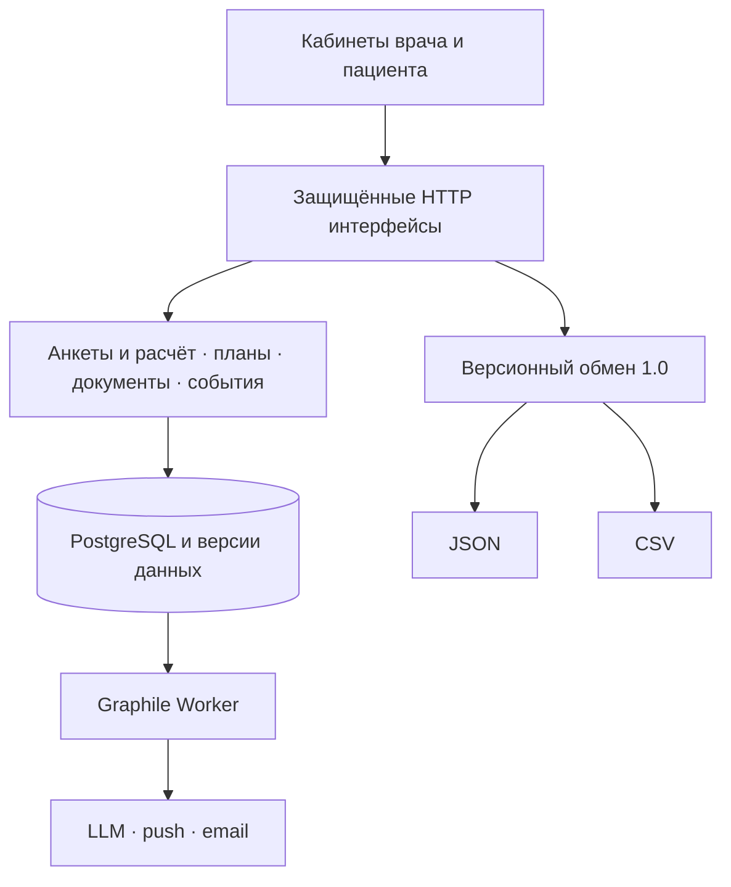

# Архитектура и расширение Контура

Контур построен как модульный монолит Next.js и отдельный фоновый процесс Graphile Worker с общей PostgreSQL. Это конкретная архитектура текущего приложения, а не заявление о готовности к любой нагрузке или любой МИС.

## Что действительно меняется независимо

- Вопросы, варианты ответов, баллы, поддерживаемые пороги и действия задаются версионным определением. На временной учебной шкале проверены публикация JSON, расчёт, запрет перезаписи и новая версия без изменения расчётного ядра.
- Внешние форматы используют стабильный контракт `1.0`, а не Prisma-модель. Два работающих адаптера — JSON и CSV. Изменение отображения или добавление внутреннего поля не меняет контракт молча.
- Веб-часть и фоновый обработчик запускаются раздельно. Источники, результаты и задания сохраняются в PostgreSQL. Статусы внешней доставки отделены от клинических действий.
- Mistral и Groq выбираются серверной конфигурацией. Проверка цитат, разрешённых действий и сохранение обобщения остаются в приложении.

## Что нельзя обещать без дополнительных работ

Новый неподдерживаемый алгоритм расчёта требует разработки и тестов; изменение модели может потребовать миграции. Модули используют общую базу и некоторые общие контракты, поэтому они не полностью независимы. Ограничитель параллельного обобщения имеет локальное состояние процесса: несколько веб-реплик требуют проверки глобальных лимитов. Экспорт не является FHIR и не включает сервисную авторизацию или готовые коннекторы конкретных МИС.

## Проверки и эксплуатация

`npm run architecture:check` проверяет статический граф импортов: серверные библиотеки не попадают в клиентские зависимости, расчётное ядро не зависит от HTTP, Prisma или внешних провайдеров. Это проверка импортов, а не формальная верификация безопасности.

`npm run assessment:publish -- definition.json` публикует локальное учебное определение. Контрольный сценарий — `npx tsx scripts/check-extensibility.ts`. Публикация клинического одобрения этим помощником запрещена.

`npm run db:restore-check` создаёт снимок локальной базы, восстанавливает отдельную временную базу и сравнивает количества и содержимое критичных таблиц. Продакшен-регламент резервирования и внешняя защита копий согласуются отдельно.

Точные условия измерений и пределы подтверждения приведены в документах по 13 техническим и 6 общим критериям. Не заявляются проведённая клиническая апробация, полная нормативная сертификация или предельное число пользователей.
